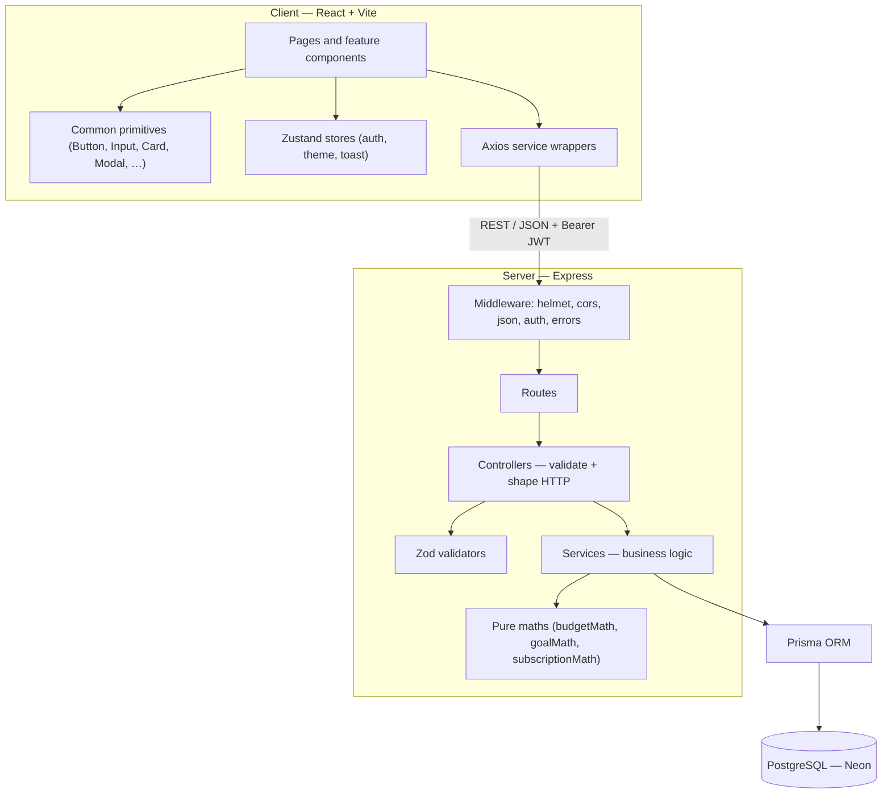
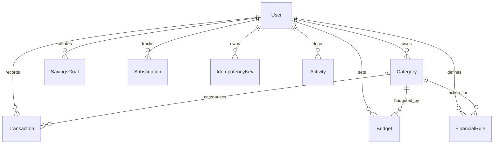

# FinTrack

**A full-stack personal finance manager: track income and expenses, set monthly budgets, save toward goals, monitor subscriptions, and see it all on a dashboard.**

FinTrack is built as a software engineering course project for the **Software Engineering and Project Management (SEPM)** mid-semester evaluation at **MNNIT Allahabad**, and is engineered to a production-style standard: layered architecture, integer-only money handling, idempotent writes, atomic budget updates, and a test suite that runs without a live server.

---

## Table of contents

- [Project introduction](#project-introduction)
- [Features and implementation status](#features-and-implementation-status)
- [Technology stack](#technology-stack)
- [Screenshots and demonstration](#screenshots-and-demonstration)
- [Getting started](#getting-started)
- [Repository structure](#repository-structure)
- [Software engineering process](#software-engineering-process)
- [Requirements specification](#requirements-specification)
- [Architecture and design](#architecture-and-design)
- [Core logic explained](#core-logic-explained)
- [Database design](#database-design)
- [Testing and verification](#testing-and-verification)
- [Security, reliability, and design decisions](#security-reliability-and-design-decisions)
- [Project management](#project-management)
- [Limitations and future scope](#limitations-and-future-scope)
- [Team and academic information](#team-and-academic-information)
- [Documentation index and academic integrity](#documentation-index-and-academic-integrity)

---

## Project introduction

### The problem

Personal finance is usually spread across bank apps, UPI histories, spreadsheets, and memory. The result is that people do not know what they spent last month by category, whether a budget is about to break, how much they still need to save for a goal, or how much their subscriptions quietly cost each year.

FinTrack solves the core of that problem in one place:

- record income, expenses and transfers,
- file them under categories,
- set a monthly budget per category and watch utilisation cross alert thresholds,
- track savings goals and the monthly amount still required,
- track recurring subscriptions and their true monthly and annual cost,
- and read the resulting position on one dashboard.

### Intended users and main use cases

FinTrack targets an individual user who wants a structured view of their own money rather than a shared-accounting or business bookkeeping product. The primary use cases exercised by the implemented application are:

1. Register an account and sign in.
2. Record and categorise transactions, including editing and deleting them.
3. Search and filter the transaction ledger.
4. Create a monthly budget per category and receive 80% / 100% threshold alerts.
5. Create savings goals and see the required monthly contribution.
6. Track subscriptions and see the monthly and annual roll-up plus upcoming renewals.
7. Read a monthly dashboard summary with a category breakdown and recent activity.
8. Use the app in light or dark mode on desktop or mobile.

### Academic context

- **Course:** Software Engineering and Project Management (SEPM)
- **Institution:** MNNIT Allahabad
- **Evaluation:** Mid-semester evaluation
- **Mid-semester target flow:** login → add a transaction → see the budget update → see it reflected on the dashboard

The mid-semester checkpoint requires one fully working end-to-end feature, not every planned feature. The increment status in this README reflects that reality: the core financial flows (auth, transactions, budgets, goals, dashboard, subscriptions) are implemented, while the rule engine, forecasting, anomaly flagging, reports and AI enhancements remain on the roadmap. See [`progress.md`](./progress.md) for the authoritative status board.

### Project summary

FinTrack is an npm-workspaces monorepo with a React + Vite single-page client, an Express + Prisma API server, and a PostgreSQL database. Money is stored and calculated as **integer paise** end to end, transaction creation is **idempotent**, and budget spend is moved with a single atomic database increment so concurrent writes cannot lose updates. The repository is documented as it is built: requirements and backlog in `features.md`, architecture in `architecture.md`, schema in `database-schema.md`, conventions in `conventions.md`, and status in `progress.md`.

---

## Features and implementation status

Statuses are grounded in the source code and in [`progress.md`](./progress.md). Where a feature is implemented but its database-backed integration suite could not be executed (no `TEST_DATABASE_URL` on the development machine), that is stated explicitly rather than hidden.

### Feature status

| Area             | Feature                                        | Status      | Evidence / notes                                                                                                              |
| ---------------- | ---------------------------------------------- | ----------- | ----------------------------------------------------------------------------------------------------------------------------- |
| Auth             | Registration and login                         | Done        | `authService.js`, `authController.js`, `authRoutes.js`, `LoginPage.jsx`, `RegisterPage.jsx`                                   |
| Auth             | JWT-protected routes                           | Done        | `authMiddleware.js`, `RequireAuth.jsx`; HS256, 1-hour tokens                                                                  |
| Auth             | Password hashing                               | Done        | bcrypt cost 12 in `authService.js`                                                                                            |
| Auth             | Rate limiting on `/api/auth/*`                 | Not started | Listed as an open item in `progress.md`                                                                                       |
| Transactions     | Create / list / get / edit / delete            | Done        | `transactionService.js`, `transactionController.js`, `TransactionsPage.jsx`                                                   |
| Transactions     | Type support: income, expense, transfer        | Done        | `TxType` enum and transaction form                                                                                            |
| Transactions     | Idempotent creation via `Idempotency-Key`      | Done        | `IdempotencyKey` table, unit tests; HTTP integration suite written but unrun                                                  |
| Transactions     | Search and filters                             | Done        | UI: search, category, from/to date, payment method; API also supports `type` and cursor pagination                            |
| Transactions     | Category pickers load real UUIDs               | Done        | `GET /api/categories`; no hardcoded category ids                                                                              |
| Budgets          | Monthly budget per category                    | Done        | `Budget` unique `(userId, categoryId, period)`                                                                                |
| Budgets          | Utilisation and 80% / 100% alerts              | Done        | `budgetMath.js`, `BudgetsPage.jsx` + toasts                                                                                   |
| Budgets          | Concurrency-safe atomic spend increment        | Done        | `applyTransactionToBudget` uses `{ spent: { increment } }`; unit-test guarded; concurrency integration test written but unrun |
| Budgets          | Spend roll-back on transaction edit/delete     | Not started | Known deviation: editing or deleting a transaction does not yet decrement `Budget.spent`                                      |
| Goals            | Create / list / edit / delete goals            | Done        | `goalService.js`, `goalMath.js`, `GoalsPage.jsx`; delete action added on the card                                             |
| Goals            | Required monthly contribution                  | Done        | Pure integer maths with rounding up and overdue handling                                                                      |
| Dashboard        | Summary cards, all-time balance, period totals | Done        | `dashboardService.js`, `DashboardPage.jsx`, `SummaryCard.jsx`                                                                 |
| Dashboard        | Category breakdown chart                       | Done        | Recharts donut + `categoryColors.js`                                                                                          |
| Dashboard        | Recent transactions                            | Done        | Last 5 rows in the same dashboard payload                                                                                     |
| Subscriptions    | CRUD                                           | Done        | `subscriptionService.js`, `SubscriptionsPage.jsx`                                                                             |
| Subscriptions    | Monthly / annual roll-up                       | Done        | `subscriptionMath.js`; monthly and yearly normalisation                                                                       |
| Subscriptions    | Renewal reminders                              | Done        | `daysUntilRenewal`, 0–7 day warning window                                                                                    |
| Theming          | Light / dark mode                              | Done        | Tailwind v4 tokens, `uiStore.js`, `ThemeToggle.jsx`                                                                           |
| Demo data        | Demo seed script                               | Done        | `server/prisma/seedDemo.js`, `npm run db:seed:demo`                                                                           |
| Rule engine      | Priority rules, first match wins               | Not started | Schema model exists, service/UI do not                                                                                        |
| Forecasting      | Next-period spend prediction                   | Not started | —                                                                                                                             |
| Anomaly flagging | Deterministic threshold check                  | Not started | —                                                                                                                             |
| Reports          | Monthly/category/yearly reports                | Not started | `/reports` renders a placeholder page                                                                                         |
| AI enhancements  | Categorisation / summary / anomaly text        | Not started | Groq not integrated; `GROQ_API_KEY` reserved in env template                                                                  |
| Deployment       | Vercel + Render + Neon                         | Not started | Topology documented in `architecture.md`; no deploy config in repo                                                            |
| Demo video       | Recorded walkthrough                           | Not started | Open item in `progress.md`                                                                                                    |

### Increment status

The same status board used by the team (`progress.md`) tracks 13 increments:

| #   | Increment                                        | Status      |
| --- | ------------------------------------------------ | ----------- |
| 1   | Foundation (auth, skeleton, DB, deploy pipeline) | In progress |
| 2   | Transactions (CRUD, idempotency)                 | Done        |
| 3   | Budgets (utilisation, concurrency-safe update)   | In progress |
| 4   | Savings Goals                                    | In progress |
| 5   | Dashboard                                        | In progress |
| 6   | Subscriptions                                    | In progress |
| 7   | Rule Engine                                      | Not started |
| 8   | Forecasting                                      | Not started |
| 9   | Anomaly Flagging                                 | Not started |
| 10  | Reports                                          | Not started |
| 11  | AI Enhancements                                  | Not started |
| 12  | Hardening & Testing                              | Not started |
| 13  | Deployment & Demo Prep                           | Not started |

"In progress" for increments 3–6 means the feature is built and unit/component tested, but its database-backed HTTP integration suite has not been executed, and some increments still carry known gaps (for example, budget spend not rolling back on transaction edit/delete).

---

## Technology stack

| Layer                | Technology                                        | Notes                                                           |
| -------------------- | ------------------------------------------------- | --------------------------------------------------------------- |
| Frontend             | React 19 + Vite 8                                 | SPA with route-based pages                                      |
| Styling              | Tailwind CSS v4                                   | Token-based theme, light and dark                               |
| Routing              | React Router 7                                    | Layout route for the authenticated shell                        |
| State                | Zustand 5                                         | `authStore`, `uiStore` (theme), `toastStore`                    |
| HTTP client          | Axios                                             | Single instance with bearer token + timeout + normalised errors |
| Charts               | Recharts 3                                        | Dashboard category donut                                        |
| Icons                | lucide-react                                      | Icon set used across the UI                                     |
| Fonts                | `@fontsource-variable/inter`                      | Self-hosted Inter variable font                                 |
| Backend              | Node.js (>= 20) + Express 5                       | REST API                                                        |
| ORM                  | Prisma 6.19.3                                     | Pinned (see design decisions)                                   |
| Database             | PostgreSQL                                        | Neon free tier in development; pooled + direct URLs             |
| Validation           | Zod 4                                             | Request schemas shared through `commonValidator.js`             |
| Auth                 | `jsonwebtoken` + `bcrypt`                         | HS256 tokens, bcrypt cost 12                                    |
| Security middleware  | `helmet`, `cors`                                  | Applied globally in `app.js`                                    |
| Logging              | `morgan`                                          | Development request logging                                     |
| Environment          | `dotenv`                                          | Loaded in `app.js`                                              |
| Testing              | Vitest 5, Testing Library, Supertest, jsdom       | Separate node and jsdom environments                            |
| AI (planned)         | Groq API                                          | Not integrated; env key reserved                                |
| Deployment (planned) | Vercel (client), Render (server), Neon (database) | Documented, not configured                                      |

### Why these choices

- **PostgreSQL with Prisma.** The data is highly relational: transactions point at categories, budgets are a unique triple of user/category/period, and idempotency keys are a unique pair. PostgreSQL enforces those invariants with real constraints, and Prisma gives a typed schema, migrations, and an atomic `increment` that removes read-modify-write races on budget spend.
- **Integer paise, never floats.** All monetary amounts are stored as `Int` paise (`₹1 = 100`). Floating-point money produces rounding drift; integer arithmetic does not. Conversion to `₹` display happens only at the presentation boundary (`client/src/utils/formatters.js`).
- **Zod at the HTTP edge.** Every request body, query string and route parameter is parsed by a Zod schema before the controller calls a service, so an out-of-range amount is a `400` with field details rather than a Prisma `500`.
- **Pure maths split from services.** Threshold, goal and subscription maths live in `*Math.js` files with no Prisma import, so they are unit-testable with literals and can also feed client test fixtures through the exact function that ships.

---

## Screenshots and demonstration

No screenshots or demo-video files are currently stored in the repository, and no video URL is present. Add them when available.

### Screenshots

| Screen           | Placeholder                                                     |
| ---------------- | --------------------------------------------------------------- |
| Login / Register | `TODO: add screenshot — client/src/pages/LoginPage.jsx`         |
| Dashboard        | `TODO: add screenshot — client/src/pages/DashboardPage.jsx`     |
| Transactions     | `TODO: add screenshot — client/src/pages/TransactionsPage.jsx`  |
| Budgets          | `TODO: add screenshot — client/src/pages/BudgetsPage.jsx`       |
| Savings Goals    | `TODO: add screenshot — client/src/pages/GoalsPage.jsx`         |
| Subscriptions    | `TODO: add screenshot — client/src/pages/SubscriptionsPage.jsx` |
| Dark mode        | `TODO: add screenshot of the same page in dark mode`            |

Suggested replacement path once captured: `docs/screenshots/<screen>.png`, referenced from this table.

### Demo video

`TODO: add a public demo-video URL when the mid-semester walkthrough is recorded.`

The repository supports a repeatable demo dataset: see [Demo data](#demo-data) under Getting started.

---

## Getting started

### Prerequisites

- **Node.js >= 20** (declared in the root and server `engines`).
- **npm** (bundled with Node).
- A **PostgreSQL** database. Development used the free **Neon** tier, whose pooled/direct connection split the project's Prisma configuration expects.
- Optionally, a **Groq API key** for the planned AI layer. The feature is not implemented, so the key is not required to run the app.

### 1. Clone

```bash
git clone https://github.com/TechBhaskar05/SEPM.git
cd SEPM
```

### 2. Install dependencies

Run this from the repository root. The project uses npm workspaces (`client` and `server`), so one install covers both. The server's `postinstall` runs `prisma generate`, because the generated Prisma client is gitignored.

```bash
npm install
```

### 3. Configure environment variables

Never commit real `.env` files; only `.env.example` templates are tracked.

**Server**

```bash
cp server/.env.example server/.env
```

Then fill in `server/.env`:

| Variable            | Purpose                                                           |
| ------------------- | ----------------------------------------------------------------- |
| `DATABASE_URL`      | Pooled PostgreSQL connection used by the app at runtime           |
| `DIRECT_URL`        | Direct connection used only by `prisma migrate`                   |
| `JWT_SECRET`        | Long random string used to sign JWTs                              |
| `GROQ_API_KEY`      | Reserved for the planned AI layer; can be left empty              |
| `PORT`              | Local port, defaults to `5001`                                    |
| `TEST_DATABASE_URL` | Throwaway database for integration suites; optional for local dev |

On Neon, use the **pooled** connection string as `DATABASE_URL` and the **direct** string as `DIRECT_URL`. A Neon dev branch is the cheapest option for `TEST_DATABASE_URL`.

**Client**

```bash
cp client/.env.example client/.env
```

`VITE_API_BASE_URL` already points at `http://localhost:5001/api`, matching the server default, so the default file works locally.

### 4. Create the schema

From the `server` directory, apply the existing migration:

```bash
cd server
npx prisma migrate deploy
```

For ongoing local development, create new migrations with:

```bash
npx prisma migrate dev --name <change-description>
```

### 5. Seed the database

System categories are seeded by a script (not a migration):

```bash
npm run db:seed --workspace server
```

For a realistic demo dataset (one demo user with transactions, budgets, goals and subscriptions), run:

```bash
npm run db:seed:demo --workspace server
```

`seedDemo.js` resets the demo user's financial data and seeds relative dates, so it is best re-run on the day of a demo. It does not touch other users.

### 6. Run the app

From the repository root:

```bash
npm run dev
```

This starts both workspaces:

- client: `http://localhost:5173`
- server: `http://localhost:5001`

The health endpoint is `GET http://localhost:5001/api/health` and returns `{ "status": "ok" }`.

### 7. Demo credentials

The demo seed creates a single demo account:

```text
Email:    demo@example.com
Password: Demo@12345
```

These are demo-only credentials generated by the seed script. Do not reuse them anywhere real.

### Available npm scripts

Run workspace scripts from the repository root with `--workspace`.

| Command                                   | What it does                                   |
| ----------------------------------------- | ---------------------------------------------- |
| `npm run dev`                             | Runs client and server together                |
| `npm run dev:client`                      | Vite dev server only                           |
| `npm run dev:server`                      | Express server with `node --watch`             |
| `npm run build`                           | Production build of the client                 |
| `npm start`                               | Starts the server (`node src/index.js`)        |
| `npm test`                                | Server unit tests (`server/tests/unit`)        |
| `npm run test:unit`                       | Alias for server unit tests                    |
| `npm run test:integration`                | DB-backed suites; requires `TEST_DATABASE_URL` |
| `npm run test:all`                        | All server tests; requires a test database     |
| `npm run test --workspace client`         | Client unit and integration tests (jsdom)      |
| `npm run lint`                            | ESLint for client and server                   |
| `npm run lint:fix`                        | ESLint with `--fix` for both workspaces        |
| `npm run format`                          | Prettier write for both workspaces             |
| `npm run format:check`                    | Prettier check for both workspaces             |
| `npm run db:seed --workspace server`      | Seed system categories                         |
| `npm run db:seed:demo --workspace server` | Seed the reset-table demo dataset              |

#### Demo data

`server/prisma/seedDemo.js` creates, for the demo user only:

- 35 transactions across current and previous months, covering multiple categories and payment methods;
- 6 monthly budgets with matching spend, including approaching and exceeded states;
- 3 savings goals at different progress levels;
- 4 subscriptions with different frequencies and renewal windows.

Expected seeded totals (used by the mid-semester demo): current-month income `₹1,03,000`, expenses `₹21,498.50`, savings `₹81,501.50`, all-time total balance `₹1,89,151.50`.

---

## Repository structure

```text
SEPM/
├── client/                          # React + Vite single-page application
│   ├── public/
│   ├── src/
│   │   ├── components/
│   │   │   ├── auth/                # AuthLayout, RequireAuth
│   │   │   ├── budgets/             # BudgetCard, BudgetForm, BudgetProgress
│   │   │   ├── common/              # Button, Input, Select, Card, Modal, Badge, Toast, …
│   │   │   ├── dashboard/           # SummaryCard, CategoryBreakdownChart, RecentTransactions
│   │   │   ├── goals/               # GoalCard, GoalForm, GoalProgressRing
│   │   │   ├── layout/              # AppShell, Sidebar, TopBar, navigation
│   │   │   ├── subscriptions/       # SubscriptionCard, SubscriptionForm
│   │   │   ├── ThemeToggle.jsx
│   │   │   └── PagePlaceholder.jsx
│   │   ├── pages/                   # One route per page
│   │   ├── services/                # Axios wrappers, one per entity
│   │   ├── store/                   # Zustand: authStore, uiStore, toastStore
│   │   ├── utils/                   # formatters, validation, categoryColors
│   │   ├── index.css                # Tailwind entry + theme tokens
│   │   ├── App.jsx                  # Route table
│   │   └── main.jsx                 # Bootstrap + ToastViewport
│   ├── tests/
│   │   ├── fixtures/                # Fixtures built from real server maths
│   │   ├── integration/             # Page-level tests
│   │   └── unit/                    # Component and utility tests
│   ├── tailwind.config.js           # Raw palette + semantic token wiring
│   └── vite.config.js               # Vite + Vitest (jsdom) configuration
│
├── server/                          # Express + Prisma API
│   ├── prisma/
│   │   ├── migrations/              # Applied migrations (init)
│   │   ├── schema.prisma            # Source of truth for the data model
│   │   ├── seed.js                  # System categories
│   │   └── seedDemo.js              # Demo dataset
│   ├── src/
│   │   ├── controllers/             # HTTP shaping only
│   │   ├── lib/                     # prismaClient, typed errors
│   │   ├── middleware/              # authMiddleware, errorHandler
│   │   ├── routes/                  # Route definitions + middleware wiring
│   │   ├── services/                # Business logic + pure maths
│   │   ├── validators/              # Zod request schemas
│   │   ├── app.js                   # Express app assembly
│   │   └── index.js                 # Server entry point
│   ├── tests/
│   │   ├── integration/             # Supertest + real DB (require TEST_DATABASE_URL)
│   │   └── unit/                    # Prisma and bcrypt mocked
│   └── vitest.config.js             # Node test environment
│
├── architecture.md                  # Layers, request flows, module boundaries
├── conventions.md                   # Folder structure, money rules, testing, git
├── database-schema.md               # Target schema and atomicity requirements
├── features.md                      # Backlog with MoSCoW priority and FR IDs
├── progress.md                      # Authoritative increment status board
├── prompts_context.md               # AI-assistant entry point and principles
├── package.json                     # Workspace scripts
└── README.md
```

### What matters most

- `server/src/services/` holds all business logic; controllers never import Prisma.
- `server/src/services/*Math.js` holds pure, Prisma-free maths for budgets, goals and subscriptions.
- `client/src/components/common/` is the shared primitive layer and knows nothing about feature stores or services.
- `client/tests/fixtures/` imports the server's real maths functions, so client fixtures cannot drift from server behaviour.
- `progress.md` is the single status board and is updated as features move.

---

## Software engineering process

The project follows **incremental development**, sequenced so each increment depends on the one before it. The order documented in `prompts_context.md` and tracked in `progress.md` is:

```text
Foundation → Transactions → Budgets → Goals → Dashboard → Subscriptions
→ Rule Engine → Forecasting → Reports → AI Enhancements → Hardening/Testing → Deployment
```

### Increment dependencies

| Increment                       | Depends on                               | Reason                                                              |
| ------------------------------- | ---------------------------------------- | ------------------------------------------------------------------- |
| Foundation                      | —                                        | Auth, schema, tokens and app shell are prerequisites for every page |
| Transactions                    | Foundation                               | Needs auth, categories and the database                             |
| Budgets                         | Transactions                             | Budget spend is driven by recorded expenses                         |
| Goals                           | Foundation                               | Independent of transactions; needs auth and schema                  |
| Dashboard                       | Transactions                             | Aggregates transaction data                                         |
| Subscriptions                   | Foundation                               | Independent recurring-cost tracking                                 |
| Rule engine                     | Transactions + categories                | Rules assign categories to new transactions                         |
| Forecasting / Anomaly / Reports | Transactions                             | All derive from transaction history                                 |
| AI enhancements                 | Rule engine + deterministic calculations | AI phrases results; it never computes them                          |

### Why incremental development fits

The mid-semester evaluation requires one fully working end-to-end flow rather than a broad, shallow prototype. Incremental delivery lets the team keep `main` buildable and testable after each step, and it matches the natural dependency chain: transactions must exist before budgets or a dashboard can mean anything. The documented mid-semester flow (login → add transaction → budget updates → dashboard reflects it) is exactly the first four increments.

### Version control and change management

`conventions.md` defines the working agreement:

- one branch per feature: `feature/<short-name>`;
- conventional commit messages: `feat`, `fix`, `test`, `docs`, `refactor`, `chore`;
- small, focused commits rather than one commit per day;
- `main` must always build and pass tests.

Documented deviations from the original plan are recorded at the bottom of `progress.md`, `architecture.md`, `conventions.md` and `database-schema.md`, with a date and reason, rather than changed silently.

---

## Requirements specification

The project's documented requirement IDs are used where they exist. Rows without an ID are **README summaries** of behaviour visible in the code, not official project identifiers.

### Functional requirements

| ID          | Requirement                                                                                                   | Status                                                         |
| ----------- | ------------------------------------------------------------------------------------------------------------- | -------------------------------------------------------------- |
| FR-AUTH-01  | Authenticate a valid user and reject invalid credentials with a clear error                                   | Implemented                                                    |
| FR-TRANS-01 | Record a transaction with amount, description, category, date and type                                        | Implemented                                                    |
| FR-TRANS-02 | Categorise a transaction                                                                                      | Implemented (manual category selection; rule/AI paths planned) |
| FR-TRANS-03 | Duplicate submission with the same idempotency key returns the original result and never creates a second row | Implemented                                                    |
| FR-BUD-01   | Define a monthly budget for a category                                                                        | Implemented                                                    |
| FR-BUD-02   | Calculate budget utilisation from recorded transactions                                                       | Implemented                                                    |
| FR-GOAL-01  | Create a savings goal with a target and deadline                                                              | Implemented                                                    |
| FR-SUB-01   | Track subscriptions and compute cost roll-ups                                                                 | Implemented                                                    |
| FR-RULE-01  | Evaluate rules in priority order; first match applies                                                         | Not implemented                                                |
| FR-FCST-01  | Forecast next-period spend per category from history                                                          | Not implemented                                                |

### Non-functional requirements

| ID             | Requirement                                                                               | Status                                                                            |
| -------------- | ----------------------------------------------------------------------------------------- | --------------------------------------------------------------------------------- |
| NFR-REL-02     | Budget updates are safe under concurrent writes (no lost updates)                         | Implemented with atomic increment; concurrency integration test written but unrun |
| NFR-MNT-01     | Business logic lives in the service layer and is unit-testable                            | Implemented; services are unit-tested with mocked Prisma                          |
| README summary | Money is never stored or calculated as a float                                            | Implemented: `Int` paise columns, integer arithmetic                              |
| README summary | Passwords are stored only as bcrypt hashes and never returned to clients                  | Implemented                                                                       |
| README summary | Protected endpoints require a valid bearer token and scope data to the authenticated user | Implemented                                                                       |
| README summary | Unexpected errors never leak stack traces or raw database messages                        | Implemented in `errorHandler.js`                                                  |
| README summary | The application runs on free infrastructure only                                          | Honoured in dependency choices so far; deployment still outstanding               |

---

## Architecture and design

### High-level architecture



### Layering rules

The strict layering in `architecture.md` is followed in the code:

1. **Routes** define method and path, attach middleware, and call a controller. No business logic.
2. **Controllers** parse and validate with Zod, call services, and shape the HTTP response. They do not import Prisma.
3. **Services** hold all business logic and own database access through the shared Prisma client.
4. **`lib/prismaClient.js`** is the single Prisma instance, imported by services only.

Middleware handles cross-cutting concerns: `helmet`, `cors`, JSON parsing, `morgan` logging, bearer-token authentication, and a single terminal error handler.

### Request flow example — create a transaction

```text
TransactionForm.jsx
  → POST /api/transactions with Idempotency-Key header
    → route → authMiddleware → controller parses body with Zod
      → transactionService.createTransaction(userId, data, key)
          1. look up (userId, key); replay a stored response if present
          2. otherwise, in one Prisma $transaction:
               - create the transaction row
               - if it is a categorised expense, atomically increment the matching budget
               - store the idempotency key + response
      → controller returns the stored/original status code
```

### API overview

Every path below is mounted under `/api`. Except for register and login, all routes require `Authorization: Bearer <token>`.

| Method | Path                        | Description                                       |
| ------ | --------------------------- | ------------------------------------------------- |
| POST   | `/auth/register`            | Create an account, return a JWT                   |
| POST   | `/auth/login`               | Verify credentials, return a JWT                  |
| GET    | `/auth/me`                  | Return the current user                           |
| GET    | `/categories`               | List the user's categories plus system defaults   |
| POST   | `/transactions`             | Create a transaction (requires `Idempotency-Key`) |
| GET    | `/transactions`             | List with filters and cursor pagination           |
| GET    | `/transactions/:id`         | Fetch one transaction                             |
| PATCH  | `/transactions/:id`         | Update a transaction                              |
| DELETE | `/transactions/:id`         | Delete a transaction                              |
| POST   | `/budgets`                  | Create a monthly budget                           |
| GET    | `/budgets`                  | List budgets                                      |
| GET    | `/budgets/:id`              | Fetch one budget                                  |
| PATCH  | `/budgets/:id`              | Update a budget limit                             |
| DELETE | `/budgets/:id`              | Delete a budget                                   |
| POST   | `/savings-goals`            | Create a goal                                     |
| GET    | `/savings-goals`            | List goals with derived fields                    |
| GET    | `/savings-goals/:id`        | Fetch one goal                                    |
| PATCH  | `/savings-goals/:id`        | Update a goal                                     |
| DELETE | `/savings-goals/:id`        | Delete a goal                                     |
| POST   | `/subscriptions`            | Create a subscription                             |
| GET    | `/subscriptions`            | List subscriptions plus roll-up totals            |
| GET    | `/subscriptions/:id`        | Fetch one subscription                            |
| PATCH  | `/subscriptions/:id`        | Update a subscription                             |
| DELETE | `/subscriptions/:id`        | Delete a subscription                             |
| GET    | `/dashboard?period=YYYY-MM` | Summary, category breakdown, recent transactions  |
| GET    | `/health`                   | Health check                                      |

Errors share one envelope: `{ "error": { "code": "...", "message": "...", "details": { ... } } }`.

---

## Core logic explained

### Money as integer paise

All amounts are integers in the smallest currency unit (paise, where `₹1 = 100`). A display value of `₹1,249.00` crosses the API as `124900`. The shared Zod `paise` schema rejects non-integers rather than rounding them, and the Prisma columns are `Int`. Conversion happens only in `client/src/utils/formatters.js` (display) and in the amount inputs of forms (rupees → paise).

The int4 maximum is `2,147,483,647` paise (about ₹2.1 crore), which is asserted as `PAISE_MAX` so an out-of-range value returns a `400` instead of a database error.

### Transaction types and categorisation

`TxType` is `income`, `expense` or `transfer`. `TxSource` records how a row was categorised (`manual` today; `rule` and `ai` reserved for later increments). A transaction may have a null category, which the UI shows as "Uncategorised". Transfers are excluded from income, expense, savings and budget totals, because without an account model a transfer is neither earned nor spent.

### Idempotent transaction creation

Every `POST /api/transactions` requires an `Idempotency-Key` header. The server:

1. looks up `(userId, key)` in `IdempotencyKey`;
2. if found and younger than 24 hours, replays the stored response with its original status code;
3. otherwise performs the write and stores the key + response in the same transaction;
4. if two identical requests race, the unique constraint on `(userId, key)` makes the second insert fail with Prisma `P2002`, which is caught and answered with the winner's stored response.

Keys expire lazily after 24 hours: an expired key is deleted the next time it is looked up, avoiding a scheduler that free-tier hosting cannot run.

### Atomic budget updates

Budget spend is never read into JavaScript and written back. The only mutation is a single statement:

```js
prisma.budget.update({
  where: { id: budgetId },
  data: { spent: { increment: amount } },
});
```

The increment is evaluated by PostgreSQL, so N concurrent expenses all land. The service accepts an optional Prisma client so the caller can pass a `$transaction` handle and commit the transaction row and the budget increment together.

### Which budget an expense affects

A budget is matched by `(userId, categoryId, period)`, and the period is derived from **the transaction's own date**, not the current month. An expense recorded for last month counts against last month's budget. A transaction with no category, or a category with no budget for that period, is simply not budgeted; creation still succeeds.

### Budget utilisation and threshold alerts

With `spent` and `limitAmount` in paise:

```text
utilization = spent / limitAmount
utilizationPercent = round(utilization × 10000) / 100
```

Alerts fire at `>= 0.80` ("approaching") and `>= 1.00` ("exceeded"). The comparison is inclusive so hitting exactly 80% is the alert, not one paisa short.

The threshold the response reports is the threshold **this transaction crossed**, computed from the atomic update's own return value:

```text
before = evaluateThresholds(spent - amount, limitAmount)
after  = evaluateThresholds(spent, limitAmount)
crossed = after.alerts − before.alerts
```

Because the pre-increment value is exactly `spent - amount`, no second read is needed and no concurrent increment can make it lie.

**Worked example.** Food budget `₹8,000 = 800000` paise, already `₹6,800 = 680000` spent (85%, "approaching"). A new expense of `₹1,500 = 150000` makes `spent = 830000`:

```text
before = 680000 / 800000 = 0.85  → alerts [0.80]
after  = 830000 / 800000 = 1.0375 → alerts [0.80, 1.00]
crossed = [1.00] → "exceeded" alert
```

The client suppresses repeats per budget per period per threshold using `sessionStorage`, so a page reload does not re-shout an alert the user already saw.

### Savings goal contribution

The required monthly contribution is derived, never stored, so it is always current:

```text
remaining = max(targetAmount − savedAmount, 0)
months    = whole calendar months from today to the deadline (minimum 1)
required  = ceil(remaining / months)
```

Integer arithmetic implements the ceiling: `floor((remaining + months − 1) / months)`, rounded up so the goal is never left a paisa short.

Edge cases, deliberately:

- goal already met (`remaining <= 0`) → `0`, even if the deadline has passed;
- deadline in the past and goal unmet → the **whole remainder**, because there are no months left to divide by;
- deadline later today or later this month → one contribution.

**Worked example.** Target `₹1,20,000 = 12000000`, saved `₹30,000 = 3000000`, two months left:

```text
remaining = 12000000 − 3000000 = 9000000
required  = ceil(9000000 / 2) = 4500000 = ₹45,000 / month
```

### Subscription monthly and annual roll-up

For each subscription:

- `monthly`: monthly total `+= amount`; annual total `+= amount × 12`.
- `yearly`: monthly total `+= round(amount / 12)`; annual total `+= amount` (annual stays authoritative).

**Worked example.** Netflix at `₹649/month` and iCloud+ at `₹2,400/year`:

```text
monthly = 64900 + round(240000 / 12) = 64900 + 20000 = 84900 = ₹849.00 / month
annual  = (64900 × 12) + 240000       = 778800 + 240000 = 1018800 = ₹10,188.00 / year
```

Renewal status is computed in whole UTC calendar days: `isRenewalSoon` is true from 0 to 7 days (inclusive), and `isRenewalOverdue` is true below 0.

### Dashboard aggregation

The dashboard is a read-only aggregate, computed with Prisma `groupBy` rather than a JavaScript loop over the ledger:

- `totalBalance` — all-time income minus all-time expenses;
- `totalIncome`, `totalExpenses`, `savings` — scoped to the requested `YYYY-MM` period (default: current UTC month);
- `categoryBreakdown` — expense totals per category with each category's percentage of the period's expenses;
- `recentTransactions` — the latest five rows.

Transfers are excluded from every total. The response also includes `aiSummary: null`, a reserved slot for the planned AI narrative.

### Not yet implemented

The following have schema or UI placeholders but no business logic: the financial rule engine, spend forecasting, anomaly flagging, reports, and AI enhancements. The `FinancialRule` model, the `TxSource.rule`/`ai` enum values, the `/rules` and `/reports` routes, and the `GROQ_API_KEY` environment variable exist as preparation, not as working features.

---

## Database design

The schema is defined in `server/prisma/schema.prisma`, applied by the initial migration `20261018112439_init`, and specified in [`database-schema.md`](./database-schema.md).



### Tables and key columns

| Model            | Key columns                                                                                                                        | Constraints / indexes                                                           |
| ---------------- | ---------------------------------------------------------------------------------------------------------------------------------- | ------------------------------------------------------------------------------- |
| `User`           | `id` UUID PK, `name`, `email`, `passwordHash`, `createdAt`                                                                         | Unique `email`                                                                  |
| `Category`       | `id` UUID PK, `name`, `userId` nullable (null = system default)                                                                    | FK to `User` (`CASCADE`)                                                        |
| `Transaction`    | `id`, `userId`, `categoryId` nullable, `type` enum, `amount` Int paise, `description`, `paymentMethod`, `date` DATE, `source` enum | Indexes `(userId, date)` and `(userId, categoryId)`; `categoryId` FK `SET NULL` |
| `Budget`         | `id`, `userId`, `categoryId`, `period` "YYYY-MM", `limitAmount` Int, `spent` Int default 0                                         | Unique `(userId, categoryId, period)`                                           |
| `SavingsGoal`    | `id`, `userId`, `name`, `targetAmount` Int, `savedAmount` Int default 0, `deadline` DATE                                           | FK `CASCADE`                                                                    |
| `Subscription`   | `id`, `userId`, `name`, `amount` Int, `frequency` enum, `nextRenewalDate` DATE                                                     | FK `CASCADE`                                                                    |
| `FinancialRule`  | `id`, `userId`, `priority`, `conditionType` enum, `conditionValue`, `actionCategoryId`, `isActive`                                 | FKs `CASCADE` (model only; not used by a service yet)                           |
| `IdempotencyKey` | `id`, `userId`, `key`, `responseBody` JSONB, `statusCode`, `createdAt`                                                             | Unique `(userId, key)`                                                          |
| `Activity`       | `id`, `userId`, `action`, `entityId`, `metadata` JSONB nullable, `createdAt`                                                       | Model only (audit log; not yet written by a service)                            |

### Why this design suits financial data

- **Integer columns for money.** `amount`, `limitAmount`, `spent`, `targetAmount`, `savedAmount` and subscription `amount` are all `Int`, so no monetary value is ever a float.
- **Database-enforced invariants.** One budget per category per month, one email per account, and one response per idempotency key are unique constraints, not conventions a caller might forget.
- **Safe deletes.** Deleting a user cascades to their financial rows. Deleting a category does **not** delete transactions: the `Transaction.categoryId` foreign key uses `ON DELETE SET NULL`, so rows fall back to "Uncategorised" instead of disappearing.
- **Indexed access patterns.** `Transaction(userId, date)` supports date-range listing and period aggregation; `Transaction(userId, categoryId)` supports category filtering and breakdowns.
- **Derived values are not stored.** Goal contributions and budget utilisation are computed on read from their source columns, so they cannot go stale.

No connection strings, passwords or keys are stored in the repository. Environment values live only in an untracked local `.env` file created from `.env.example`.

---

## Testing and verification

### Strategy

- **Unit tests** cover services and pure maths. Prisma and bcrypt are mocked; no database or network is required.
- **Integration tests** in `server/tests/integration/` use Supertest against a real test database. They refuse to run without `TEST_DATABASE_URL` so they cannot delete rows from the development database.
- **Client tests** run in jsdom and cover components, pages and utilities with Testing Library.

Client fixtures import the server's real maths functions (`budgetMath.js`, `goalMath.js`, `toGoalView`) so component assertions move with the service rather than with a hand-copied value.

### Verified results

Results below were obtained on **2026-10-19** from a clean local run.

| Check             | Command                       | Result                                                                        |
| ----------------- | ----------------------------- | ----------------------------------------------------------------------------- |
| Server unit tests | `npm test --workspace server` | **159 passed** across 6 files                                                 |
| Client tests      | `npm test --workspace client` | **154 passed** across 18 files                                                |
| Lint              | `npm run lint`                | Passed                                                                        |
| Production build  | `npm run build`               | Succeeded; JS bundle ~754 kB (gzip ~229 kB) with Vite's >500 kB chunk warning |

### Not verified

| Check                    | Reason                                                                                                       |
| ------------------------ | ------------------------------------------------------------------------------------------------------------ |
| Server integration tests | `TEST_DATABASE_URL` is not configured on the development machine; all DB-backed suites are written but unrun |
| Budget concurrency test  | Included in the integration suite; blocked by the same missing test database                                 |
| Deployment               | No deployment has been performed from this repository                                                        |

### Requirement-to-test mapping

| Requirement / behaviour              | Implementation                                  | Test evidence                                                                                           |
| ------------------------------------ | ----------------------------------------------- | ------------------------------------------------------------------------------------------------------- |
| FR-AUTH-01                           | `authService.login` / `register`                | `server/tests/unit/authService.test.js`; integration suite written, unrun                               |
| FR-TRANS-03 (idempotency)            | `transactionService.createTransaction`          | `server/tests/unit/transactionService.test.js`                                                          |
| NFR-REL-02 (atomic budget increment) | `budgetService.applyTransactionToBudget`        | `server/tests/unit/budgetService.test.js`; `tests/integration/budgetConcurrency.test.js` written, unrun |
| FR-BUD-02 / thresholds               | `budgetMath.evaluateThresholds`, `toBudgetView` | `server/tests/unit/budgetService.test.js`; `client/tests/unit/budgets/*`                                |
| FR-GOAL-01 / contribution maths      | `goalMath.calculateRequiredMonthlyContribution` | `server/tests/unit/goalService.test.js`; goal fixtures                                                  |
| FR-SUB-01 / roll-up                  | `subscriptionMath.rollupSubscriptions`          | `server/tests/unit/subscriptionService.test.js`; `client/tests/integration/SubscriptionsPage.test.jsx`  |
| Dashboard aggregation                | `dashboardMath`, `dashboardService`             | `server/tests/unit/dashboardService.test.js`; `client/tests/integration/DashboardPage.test.jsx`         |
| Theme tokens                         | `tailwind.config.js`, `index.css`               | `client/tests/unit/theme/warningTokens.test.js`                                                         |
| Transaction filters / editing        | `TransactionsPage`, `TransactionForm`           | `client/tests/integration/TransactionsPage.test.jsx`, `client/tests/unit/transactions/*`                |
| Goal deletion                        | `GoalCard`, `GoalsPage`                         | `client/tests/unit/goals/GoalCard.test.jsx`, `client/tests/integration/GoalsPage.test.jsx`              |

---

## Security, reliability, and design decisions

### Verified security measures

- **Password hashing.** bcrypt with cost 12; `passwordHash` is never selected for responses.
- **Timing-resistant login.** A missing account still runs a bcrypt comparison against a dummy hash and returns the same error as a wrong password, so the response does not reveal whether an email exists.
- **JWT authentication.** HS256 tokens with a 1-hour lifetime; `authMiddleware` verifies the bearer token and then reloads the user from the database, so a token for a deleted account stops working immediately.
- **Input validation.** Zod schemas parse bodies, queries and params before services run; invalid input returns `400` with field-level details.
- **User scoping.** Every financial query is scoped by `userId`. A resource belonging to another user returns `404`, not `403`, so ids are not confirmed.
- **Safe error surface.** `errorHandler.js` maps typed errors and known Prisma/Zod errors to a stable envelope and returns a generic `500` for anything else. Stack traces and raw database messages are never sent to the client.
- **HTTP hardening.** `helmet`, `cors`, and a `100kb` JSON body limit are applied globally.
- **No secrets in the repository.** Only `.env.example` templates are tracked; `.env` files are gitignored.

### Verified reliability measures

- **Idempotent writes.** `Idempotency-Key` plus a unique database constraint prevents duplicate transaction rows under retries and races.
- **Atomic budget updates.** A single database-evaluated increment removes lost-update races. Unit tests assert the code never reads the budget before incrementing and never leaves the caller's transaction handle.
- **Transactional consistency.** The transaction row, the budget increment and the idempotency record commit in one Prisma `$transaction`.
- **Financial precision.** Integer paise everywhere; no float arithmetic on money.

### Deliberate design decisions and deviations

| Decision                                                   | Reason                                                                                                                    |
| ---------------------------------------------------------- | ------------------------------------------------------------------------------------------------------------------------- |
| Prisma pinned to 6.19.3                                    | Prisma 7+ moves `url`/`directUrl` out of the schema, which would break the documented Neon pooled/direct pattern          |
| Local port 5001, not 5000                                  | macOS AirPlay Receiver answers on 5000 before Express sees the request                                                    |
| Recharts added for the dashboard                           | Free/MIT and named in the backlog; the build now exceeds Vite's 500 kB warning, accepted rather than hand-rolling a chart |
| Budget matched by the transaction date's period            | A transaction recorded for last month should count against last month's budget                                            |
| Lazy idempotency-key expiry                                | Free-tier hosts cannot run a scheduler; expired keys are deleted on lookup                                                |
| `totalBalance` is all-time, other totals are period-scoped | An accumulated balance is what "Total Balance" means; scoping it to the month would restate savings                       |
| Goals use a vertical card list and a progress ring         | Goal cards carry more text than budget tiles, and a ring distinguishes them by shape                                      |
| Budget `spent` is not editable through the budget API      | It is a running total owned by the transaction path; accepting a client value would undo the atomicity guarantees         |
| No solid `Badge` variant                                   | White-on-accent does not clear WCAG AA for every tone, so the component ships subtle/outline only                         |

### Known gaps

- No rate limiting on `/api/auth/*` or write endpoints.
- Editing or deleting a transaction does not decrement `Budget.spent`.
- `DesignSystemPage.jsx` and `ComponentDemoPage.jsx` are temporary review harnesses.
- `FinancialRule` and `Activity` models exist but no service writes to them yet.

---

## Project management

### Work breakdown structure

The work is broken down by increment, as documented in `progress.md`:

- **Foundation:** auth, design tokens, app shell, common primitives, Prisma schema and migration.
- **Transactions:** CRUD, idempotency, filters, form.
- **Budgets:** CRUD, atomic spend, thresholds, alerts, UI.
- **Savings goals:** CRUD, contribution maths, progress UI.
- **Dashboard:** aggregation endpoint, summary cards, chart, recent list.
- **Subscriptions:** CRUD, roll-up, renewal warnings, UI.
- **Remaining:** rule engine, forecasting, anomaly flagging, reports, AI enhancements, hardening, deployment, demo.

### Milestone summary

| Milestone               | Scope                                           | Status                          |
| ----------------------- | ----------------------------------------------- | ------------------------------- |
| Core end-to-end flow    | Login → transaction → budget update → dashboard | Implemented, unit/client tested |
| Mid-semester evaluation | Increments 1–4 at minimum                       | Tracked in `progress.md`        |
| Remaining semester      | Increments 7–13                                 | Not started                     |

### Risk register

| Risk                                                    | Impact                                                      | Mitigation in the project                                                                                                    |
| ------------------------------------------------------- | ----------------------------------------------------------- | ---------------------------------------------------------------------------------------------------------------------------- |
| Integration tests cannot run without a test database    | DB-level behaviour, including concurrency, stays unverified | `TEST_DATABASE_URL` guard prevents accidental data loss; create a Neon dev branch to unblock                                 |
| Budget spend not rolled back on transaction edit/delete | Budget totals can become inconsistent                       | Documented deviation; mirror-image atomic decrement planned                                                                  |
| No rate limiting                                        | Credential-guessing exposure                                | Listed as an open hardening item                                                                                             |
| AI dependency unavailable or malformed                  | A feature could fail                                        | Documented rule: AI is additive with a deterministic fallback and must never change the status of an otherwise valid request |
| Free-tier database sleeps when idle                     | First request latency                                       | Acceptable for the course timeline; pooled connection string used                                                            |
| Deployment not yet performed                            | Demo depends on local setup                                 | Deployment topology documented; scripts are environment-driven                                                               |

### Requirements traceability

The requirement-to-test mapping in [Testing and verification](#testing-and-verification) traces each documented FR/NFR to its implementation and available tests. The status board in [`progress.md`](./progress.md) is the authoritative record of what has and has not been completed.

### Team responsibilities

**Not documented in the repository.** No individual contribution breakdown or task-allocation file was found. Add a `docs/` contribution document before submission if the rubric requires it.

---

## Limitations and future scope

### Current limitations

1. **Rule engine, forecasting, anomaly flagging and reports are not implemented.** Routes exist as placeholders and the `FinancialRule` model exists, but no service logic backs them.
2. **AI enhancements are not implemented.** `GROQ_API_KEY` is reserved in the env template and the architecture documents the fallback contract, but no Groq call exists yet.
3. **Database-backed integration tests are unrun** in this environment because `TEST_DATABASE_URL` is not configured.
4. **Budget spend does not roll back** when a transaction is edited or deleted.
5. **No rate limiting** on authentication or write endpoints.
6. **No deployment.** Vercel/Render/Neon topology is documented but no deployment configuration or live URL is present.
7. **Temporary review pages** (`/design-system`, `/components`) remain in the route table.
8. **The client bundle exceeds Vite's 500 kB warning threshold**, driven largely by charting.

### Deliberately excluded scope

From `features.md`:

- **Recurring-transaction auto-generation** — would need an in-process scheduler that free-tier hosts cannot run.
- **Natural-language search/filtering** — deferred indefinitely.
- Any feature requiring paid APIs, paid hosting or a paid third-party service.

### Planned future work

In roadmap order: rule engine, forecasting, anomaly flagging, reports, AI enhancements (with deterministic fallbacks), hardening (rate limiting, security review), full test execution against a test database, deployment, and the recorded demo.

---

## Team and academic information

| Field                       | Value                                              |
| --------------------------- | -------------------------------------------------- |
| Project                     | FinTrack                                           |
| Course                      | Software Engineering and Project Management (SEPM) |
| Institution                 | MNNIT Allahabad                                    |
| Evaluation                  | Mid-semester evaluation                            |
| Repository                  | https://github.com/TechBhaskar05/SEPM              |
| Team members                | `TODO: names not documented in the repository`     |
| Registration numbers        | `TODO: not documented in the repository`           |
| Instructor                  | `TODO: not documented in the repository`           |
| Individual responsibilities | `TODO: not documented in the repository`           |

The repository includes commits and merge activity from multiple contributors, so FinTrack should be treated as a team project. Replace the placeholders above with the official team details before submission.

---

## Documentation index and academic integrity

### Project documentation

| Document                                     | Purpose                                                                         |
| -------------------------------------------- | ------------------------------------------------------------------------------- |
| [`architecture.md`](./architecture.md)       | Layer rules, request flows, module boundaries, deployment topology              |
| [`database-schema.md`](./database-schema.md) | Target schema, relationships, constraints, operations requiring transactions    |
| [`features.md`](./features.md)               | Prioritised backlog (Must/Should/Could/Won't) with requirement IDs              |
| [`conventions.md`](./conventions.md)         | Folder structure, naming, money handling, idempotency, testing, git conventions |
| [`progress.md`](./progress.md)               | Authoritative increment and feature status board, including deviations          |
| [`prompts_context.md`](./prompts_context.md) | Engineering principles and entry point for contributors                         |

### Documents not present

- **SRS** — not yet present. The `docs/` directory contains only a `.gitkeep`; requirements currently live in `features.md` and this README.
- **Standalone test documentation** — not present; test strategy is described in `conventions.md` and reflected in this README.
- **AI usage disclosure** — no disclosure file was found in the repository.

### Academic integrity

All commands, paths, figures and status claims in this README are derived from the repository's source code, tests and project documentation. Where something could not be verified (integration tests, deployment, screenshots, team details), it is marked as unverified, not started, or `TODO`. No secrets, credentials or connection strings are included.
